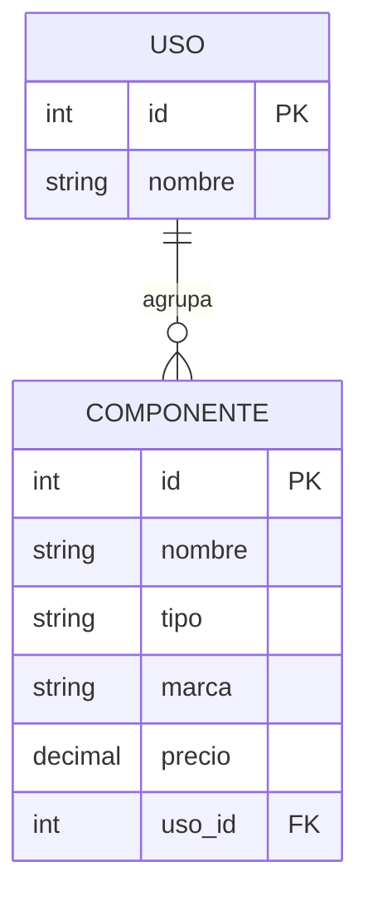

# Componentes — API (Backend)

Backend del TP de **Tecnologías Web** (TUARI/UNICEN). API REST en **NestJS** con persistencia en
**PostgreSQL** vía **TypeORM**, que administra componentes de PC agrupados por tipo de uso.

- **Relación 1 a N:** `Uso` (1) → `Componente` (N).
- CRUD completo de ambas entidades + **filtrado** por uso y **búsqueda** por nombre.
- Colección de Postman con todos los casos de uso incluida en `postman/`.

## Deploy

| Parte | URL |
| ----- | --- |
| API (Render) | https://tecnologiaswebbackend.onrender.com (ej. [`/usos`](https://tecnologiaswebbackend.onrender.com/usos)) |
| Frontend (Netlify) | https://tecnologiaswebfrontend.netlify.app |

En Render: Web Service con build `npm install && npm run build` y start `npm run start:prod`, más
una base PostgreSQL de Render conectada por su Internal Database URL (variables `DB_*` cargadas en
el panel Environment). El plan gratis "duerme" el servicio: la primera request puede tardar cerca
de un minuto. Para probar la colección de Postman contra Render, cambiar la variable `baseUrl`.

## Tecnologías

- NestJS + TypeScript
- TypeORM + PostgreSQL (`pg`)
- `class-validator` y `class-transformer` (validación de los DTOs con `ValidationPipe`)
- Docker / docker-compose (PostgreSQL + Adminer)

## Modelo de datos

**Uso**

| Campo  | Tipo   |
| ------ | ------ |
| id     | int PK |
| nombre | string |

**Componente**

| Campo   | Tipo              |
| ------- | ----------------- |
| id      | int PK            |
| nombre  | string            |
| tipo    | string            |
| marca   | string            |
| precio  | decimal           |
| uso_id  | int FK → Uso.id   |



## Requisitos

- Node.js y npm
- Docker (para la base de datos)

## Puesta en marcha

```bash
# 1. instalar dependencias
npm install

# 2. crear el archivo .env (git lo ignora) y poner en DB_PASSWORD una clave propia
cp .env.example .env

# 3. levantar PostgreSQL + Adminer (usan la DB_PASSWORD del .env)
docker compose up -d

# 4. levantar la API en modo desarrollo
npm run start:dev
```

La API queda en `http://localhost:3000`. Adminer (administrador de la DB) en `http://localhost:8080`.

CORS está habilitado (`app.enableCors()` en `src/main.ts`), para que el frontend Angular, que corre
en otro origen (`localhost:4200` o Netlify), pueda llamar a la API desde el navegador.

Al iniciar, si la tabla de usos está vacía, se **siembran** 4 usos: Gaming, Oficina, Doméstico y Estudio.

## Variables de entorno

La conexión a la base se lee de variables de entorno (ver `.env.example`). **La contraseña no está
escrita en el código**: `DB_PASSWORD` es obligatoria y, si falta, la app no arranca y avisa cuál falta.

- **En desarrollo:** las variables salen del archivo `.env`. La app lo carga al iniciar con
  `process.loadEnvFile()` (función de Node, sin librerías) y Docker Compose lee el mismo archivo para
  la contraseña del Postgres, así queda en un solo lugar. El `.env` está en el `.gitignore`.
- **En producción (Render):** no hay `.env`; las variables se cargan en el panel Environment del
  servicio.

| Variable    | Default       |
| ----------- | ------------- |
| DB_HOST     | localhost     |
| DB_PORT     | 5432          |
| DB_USERNAME | postgres      |
| DB_PASSWORD | **(obligatoria, sin valor por defecto)** |
| DB_NAME     | pc_prearmadas |
| PORT        | 3000          |

## Endpoints

### Usos

| Método | Ruta        | Descripción                          |
| ------ | ----------- | ------------------------------------ |
| GET    | `/usos`     | Listar usos                          |
| GET    | `/usos?nombre=gam` | Buscar usos por nombre (para elegir el uso al crear un componente) |
| GET    | `/usos/:id` | Obtener un uso por id                |
| POST   | `/usos`     | Crear un uso (400 si falta el nombre, 409 si ya existe) |
| PATCH  | `/usos/:id` | Actualizar un uso (400 si el nombre es vacío, 409 si ya existe) |
| DELETE | `/usos/:id` | Eliminar un uso (409 si tiene componentes) |

### Componentes

| Método | Ruta                          | Descripción                                    |
| ------ | ----------------------------- | ---------------------------------------------- |
| GET    | `/componentes`                | Listar componentes (con su uso embebido)       |
| GET    | `/componentes?usoId=1`        | **Filtrar** por uso                            |
| GET    | `/componentes?nombre=ryzen`   | **Buscar** por nombre (parcial, sin distinguir mayúsculas) |
| GET    | `/componentes/:id`            | Obtener un componente por id                   |
| POST   | `/componentes`                | Crear un componente (400 si el body es inválido, 404 si el uso no existe) |
| PATCH  | `/componentes/:id`            | Actualizar un componente (400 si un campo es inválido, 404 si no existe el componente o el uso) |
| DELETE | `/componentes/:id`            | Eliminar un componente                         |

El filtro y la búsqueda se pueden **combinar**: `/componentes?usoId=1&nombre=ryzen`.

## Validaciones y códigos de estado

El body de los POST y PATCH se valida con **`class-validator`**: cada DTO tiene decoradores
(`@IsString`, `@IsNotEmpty`, `@IsNumber`, `@Min`, `@Max`, `@IsInt`) y un `ValidationPipe` global
(`src/common/validacion.ts`, registrado en `main.ts`) los aplica. El pipe rechaza con 400 cualquier campo
que el DTO no declare (`whitelist` + `forbidNonWhitelisted`) y recorta los textos (`class-transformer`).
Los ids de la ruta usan `ParseIntPipe`, y las reglas de negocio (duplicados, 404, 409) siguen en el
controller y el service con las excepciones de NestJS.

| Código | Cuándo |
| ------ | ------ |
| 200 | Consulta, edición o borrado correctos. Un filtro sin resultados (ej. `?usoId=999`) también devuelve 200 con `[]` |
| 201 | Alta correcta de un uso o de un componente |
| 400 | Body inválido (campos faltantes, vacíos —incluido el nombre vacío de un uso en POST y PATCH—, `precio` negativo o mayor a 99999999.99, `usoId` no entero, o un body ausente), un campo no permitido en el body de un POST o PATCH (solo se aceptan `nombre`, `tipo`, `marca`, `precio` y `usoId` en componentes, y `nombre` en usos; por ejemplo un `id`, que pisaría un registro existente, o un objeto `uso`), o un `id` / `usoId` que no es un número (`ParseIntPipe`). Los errores de validación se devuelven **todos juntos** en `message`, que es un array de textos |
| 404 | El uso o el componente no existe (también al crear/editar un componente con un `usoId` inexistente, o con un id mayor al máximo de un entero de Postgres, 2147483647) |
| 409 | Conflicto con algo que ya existe: uso con nombre duplicado (se compara sin distinguir mayúsculas ni espacios; el nombre se guarda recortado), o borrar un uso que tiene componentes |

Notas: `GET /componentes?usoId=0` (o un `usoId` fuera de rango) devuelve `[]`, y el `precio` se
redondea a 2 decimales antes de guardar, para que la respuesta coincida con lo que queda en la base.

En `PATCH` solo se validan los campos que vienen en el body (actualización parcial): los `UpdateDto`
usan `PartialType`, que conserva los decoradores y vuelve opcionales los campos.

## Colección de Postman

En [`postman/Componentes.postman_collection.json`](postman/Componentes.postman_collection.json),
con todos los casos de uso: 14 requests en Usos y 17 en Componentes, incluidos los casos de error
400 / 404 / 409. Importarla en Postman con **Import → Files** y usar la variable `baseUrl` (por
defecto `http://localhost:3000`).

## Tests

```bash
npm run test
```

## Documentación y evidencia del proceso

- [`HISTORIAL.md`](HISTORIAL.md): bitácora paso a paso, con decisiones, checkpoints de comprensión
  y registro de commits.
- [`docs/resumen-opencode.md`](docs/resumen-opencode.md): resumen de la sesión con opencode
  (pasos 1 a 12).
- [`docs/resumen-claude.md`](docs/resumen-claude.md): resumen de la sesión con Claude Code
  (pasos 13 a 17).
- [`docs/logs/`](docs/logs/): logs completos de ambas sesiones.
  - `opencode-sesion.json`: export de opencode.
  - `claude-code-sesion.zip`: export de Claude Code.

## Autor

Benjamín Tiseira — Tecnologías Web, TUARI/UNICEN.
